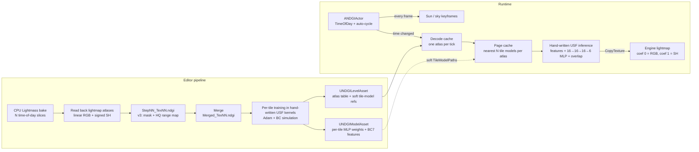
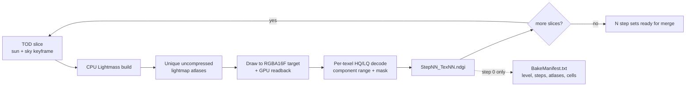
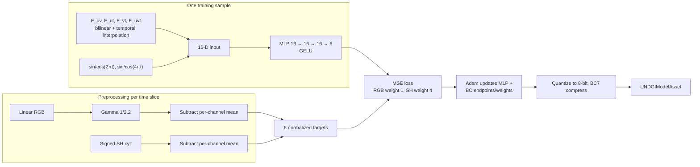
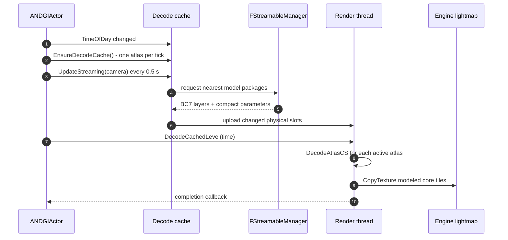
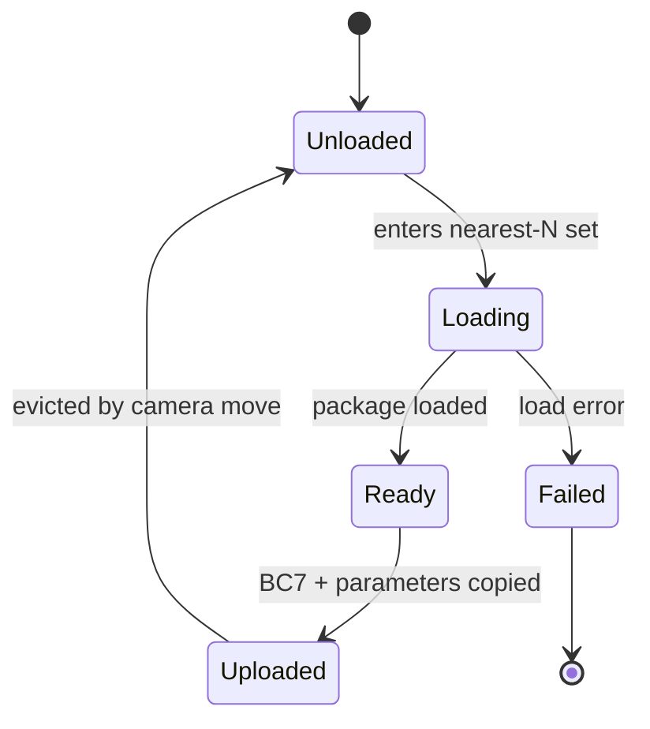

# NDGI — Neural Dynamic GI

[](https://opensource.org/licenses/MIT)


**Neural Dynamic GI for Unreal Engine 5 — temporal lightmaps compressed into per-tile MLPs trained in compute shaders. No PyTorch, no ONNX, no Unreal NNE. 45 dB PSNR, ~6 ms decode.**

NDGI implements the CVPR 2026 paper [*Neural Dynamic GI: Random-Access Neural Compression for Temporal Lightmaps in Dynamic Lighting Environments*](https://arxiv.org/pdf/2604.12625) (Wu et al.) as a UE5 plugin. It replaces the lighting stored in a level's lightmaps with per-tile MLP weight sets trained from a multi-step lighting bake. At runtime, `ANDGIActor` evaluates those weights with a hand-written USF compute shader and writes the result back into the engine's uncompressed lightmaps (RGB in coefficient 0, directional SH in coefficient 1), so static geometry keeps baked-lighting cost while the character still receives real-time directional shadows.

## Demo

**Time-of-day cycle on the test map** — dusk to daylight and back, decoded live by NDGI (`NDGITestBakeMap_WP`):

https://github.com/user-attachments/assets/479d22eb-eb27-4a96-a2f9-430962d2e83e

**Time-of-day sweep on the Sky Temple demo level** — warm daylight fading to dusk, baked lightmaps relit by NDGI:

https://github.com/user-attachments/assets/53bc1d5f-023e-4adb-adc2-26468e24bfba

## Results

| Metric | NDGI | Conditions |
|---|---|---|
| Per-tile PSNR | **45.06 dB** avg | 512×512 test atlas, 8 slices, 16-wide MLP, tile 64, overlap 8, 30,000 steps |
| Directional SH reconstruction | **28.20 dB** | Same test atlas |
| Live runtime decode | **p50 5.50 ms / p95 6.08 ms** | 19 atlases, 578 models, 67.3 MB params, 1920×1080, AMD RX 9070 XT |
| BC7 feature storage | **2.66× vs raw RGBA8**, **30.30× vs raw 8-slice set**, **2.11 BPP** | 4 models, tile 64, overlap 8, 8 slices |
| Game-thread enqueue | ~0.02 ms | Cached decode |

For reference, the paper reports 46.7 dB PSNR at 0.68 BPP, measured on its own scenes and metric — not directly comparable to the numbers above, but the same order of quality at a small fraction of the storage of raw lightmap sets.

> **No external ML framework.** NDGI does not use PyTorch, ONNX, Unreal NNE, or a generic tensor/autograd runtime. The paper's tiny MLP is reimplemented directly in USF compute shaders: `NDGIMLP.ush` contains the forward and backward passes, `NDGITrainTile.usf` contains the training step and gradient scatter, and `NDGIDecodeAtlas.usf` contains runtime inference. C++ orchestrates buffers, dispatches, and asset I/O. The CPU implementation in `NDGIReference.cpp` is only a test oracle. "Simulated" here means the model is explicit shader arithmetic, not that the optimization is fake — Adam really updates the weights and feature maps.

Each tile model has six outputs: normalized RGB followed by signed SH.xyz. SH is mean-normalized without gamma (coefficients can be negative). Bake exports are `.ndgi` v3. Version 3 adds the per-component lightmap encoding range map; v1/v2 files still load, but without that map regions whose components use different HQ ranges can be decoded incorrectly, so **retrain every atlas after updating from an older pipeline**. Models trained before the SH change (595-parameter MLP) are incompatible with the 646-parameter MLP and must be retrained.

CPU Lightmass assigns each component sharing a lightmap atlas its own HQ `Scale`/`Add` range even though the texture is shared. NDGI stores a per-texel range map in the bake export and level asset and re-encodes each texel with its owning component's range. When a component's RGB range is degenerate (an almost-uniform color), the decoder keeps the baked chroma and updates luminance through the alpha channel instead of writing saturated chroma.

All commands in the command sections below are Unreal console commands. Pipeline/training commands live in `NDGIEditor` and run in the editor. Benchmark commands live in `NDGIRuntime` and work in PIE or a `-game` session.

For current status, measurements, known issues, and next steps, see [PROGRESS.md](PROGRESS.md).

**Jump to:** [How it works](#how-ndgi-works) · [The simulated model](#the-simulated-model-no-external-ml-framework) · [Feature maps and streaming](#feature-maps-bc7-and-the-page-cache) · [Requirements](#requirements) · [Quick Start](#quick-start) · [Editor UI](#editor-ui) · [Pipeline commands](#pipeline-commands) · [Diagnostics and tests](#diagnostics-and-tests) · [Benchmarks](#benchmark-commands) · [Shipping and CI](#shipping-and-ci) · [Notes and caveats](#notes-and-caveats)

## How NDGI works

NDGI has an offline half and a runtime half. The offline half turns a multi-step Lightmass bake into small per-tile MLP weight sets and learned feature maps; the runtime half evaluates those weights through a hand-written USF compute shader only when the time of day changes. Static geometry keeps using ordinary lightmaps for shading, so NDGI adds no per-frame GI pass. The design follows the NDGI paper (arXiv 2604.12625), with the paper's network reimplemented directly in the plugin's shader code.

### The simulated model (no external ML framework)

The plugin does not load a model produced by an ML framework. It contains a fixed-shape implementation of the paper's network:

```text
x  = [F_uv(4), F_ut(2), F_vt(2), F_uvt(4), sin/cos(2πt), sin/cos(4πt)]
h1 = GELU(W1 x + b1)
h2 = GELU(W2 h1 + b2)
y  = W3 h2 + b3
y  = [normalized RGB(3), signed SH.xyz(3)]
```

The feature maps `F_uv`, `F_ut`, `F_vt`, and `F_uvt` are learned parameters as well. The loss is a weighted MSE (`RGB` weight 1, `SH` weight 4), and the training step maps the MLP input gradient back into the feature maps.

| Happening in NDGI | Not happening in NDGI |
|---|---|
| Hand-written USF forward and backward passes | PyTorch / ONNX / Unreal NNE runtime |
| Hand-written Adam updates for every parameter group | Generic autograd or tensor graph |
| Learned per-tile feature maps and MLP weights | A single shared neural network |
| Hand-coded BC-simulation during training | A generic BC7-aware ML optimizer |
| CPU reference implementation used only for validation | A second “real” model at runtime |
| Weights saved as floats, compact planes, and BC7 textures | A portable ML model file |

**Where the math lives:**

- `Shaders/Private/NDGIMLP.ush` — MLP forward, GELU, backward, and input gradients.
- `Shaders/Private/NDGITrainTile.usf` — one training step: feature sampling, MLP backward, gradient reduction, feature-map scatter.
- `Shaders/Private/NDGIDecodeAtlas.usf` and `NDGICompactTile.ush` — runtime inference and feature-array sampling.
- `Source/NDGIEditor/Private/NDGITrainAtlas.cpp` — C++ orchestration, batch dispatch, and export.
- `Source/NDGIEditor/Private/NDGIReference.cpp` — CPU test oracle; not used by the runtime.

“Training” therefore means running these hand-written kernels to fit the tile parameters, not invoking an external ML library. “Runtime decode” evaluates the same hand-written forward pass from stored weights.

### 1. End-to-end architecture



| Module | Type | Responsibility |
|---|---|---|
| `NDGIRuntime` | Runtime | `ANDGIActor`, the level/model assets, decode cache, page cache, runtime decode shader, CVars, benchmarks. |
| `NDGI` | UncookedOnly | Hand-written USF MLP/training implementation (`NDGIMLP.ush`, `NDGITrainTile.usf`, `NDGITile.ush`) plus the CPU test oracle. No external ML framework. |
| `NDGIEditor` | Editor | Bake/readback, merge, training orchestration, BC7 compression, the per-component encoding map, the pipeline panel, and validation commands. |

The bake/merge/train stages are file- and asset-based: each writes the artifact the next consumes, and any stage can be run from the editor panel or headless.

| Stage | Command | Main artifact |
|---|---|---|
| Bake | `ndgi.BakeTOD N` | `Saved/NDGI/Bake/StepNN_TexNN.ndgi` + `BakeManifest.txt` |
| Merge | `ndgi.MergeAllBakedSets N` | `Saved/NDGI/Bake/Merged_TexNN.ndgi` |
| Train | `ndgi.TrainAllAtlases <tile> <steps> <halo>` | per-tile MLP/feature assets under `/Game/NDGI/Trained`, level asset under `/Game/NDGI/Levels` |
| Validate | `ndgi.ValidateSH`, `ndgi.ValidateSeams`, `ndgi.ValidateDirectionality` | console report / CI gates |
| Runtime | `ANDGIActor` + `UNDGILevelAsset` | updated engine lightmaps |

### 2. Bake: from Lightmass to `.ndgi`

`ndgi.BakeTOD N` prepares the level for static lighting (sun and sky Stationary, `Compress Lightmaps` off, `Force No Precomputed Lighting` off, and on World Partition maps every cell force-loaded), then repeats the following N times:

1. Evaluate the time-of-day profile at `t = step / (N - 1)` and apply the sun pitch/yaw/color/intensity plus sky color/intensity. Without a profile the legacy arc is used.
2. Run CPU Lightmass. (`gpu` is accepted but currently produces no lightmaps.)
3. Collect every unique uncompressed lightmap atlas used by static mesh components (HQ when available, LQ otherwise).
4. Draw each atlas into a transient RGBA16F render target and read it back; this also hardware-decodes any compressed source format.
5. Decode each texel from Lightmass's HQ (or LQ) encoding into linear RGB and signed SH, using the `Scale`/`Add` range of the component that owns that texel, and write `StepNN_TexNN.ndgi`.



Atlases are sorted by texture path, so each atlas keeps the same `TexNN` index across steps; `MergeAllBakedSets` relies on that to append the per-step sets into one temporal set.

The coverage mask is `1` only where a lightmap UV triangle covers the texel center. Atlas padding is therefore excluded from training and validation, and the runtime copies padding through unchanged. A half-texel gutter around each island still gets a range index so the decoder can re-encode Lightmass's dilated island borders.

A `.ndgi` v3 file contains:

| Part | Contents |
|---|---|
| Header | magic, version, width/height of the coefficient-0 half, step count, gamma |
| Per step | linear float RGB, `uint8` coverage mask, signed float SH.xyz |
| v3 tail | distinct HQ ranges (`Scale0/Add0/Scale1/Add1`) and one `uint8` range index per coefficient-0 texel (`255` = padding) |

`MergeAllBakedSets` concatenates the per-step sets for every complete atlas and copies the range map from step 0. Older v1/v2 sets still load, but they have no range map; regions whose components use different HQ ranges can decode incorrectly, which is why every atlas must be retrained after upgrading.

At step 0 the baker writes `BakeManifest.txt`, a tab-separated file that scopes the pipeline to the current level:

| Field | Meaning |
|---|---|
| `Header` | `NDGI_BAKE_MANIFEST` and format version |
| `Level` | level package the bake belongs to |
| `Steps` | number of time slices |
| `Timestamp` | bake time; training skips merged sets older than the current bake |
| `Atlas` | atlas index, texture object path, width, height, and the semicolon-separated streaming-level packages (cells) that own it |

`MergeAllBakedSets` and `TrainAllAtlases` only process atlases whose manifest level matches the current editor world, so stale files from another level in the shared bake folder are ignored.

### 3. Atlas and tile layout

A lightmap atlas packs both coefficient sets into one texture: coefficient 0 (RGB + log luminance) in the top half and coefficient 1 (directional SH) in the bottom half. NDGI tiles only the coefficient-0 half.

```
Full lightmap atlas
┌──────────────────────────────────────────┐
│ coefficient 0: RGB + logL (top half)     │
│  ┌────┬────┬────┬────┐                   │
│  │ M  │ M  │ M  │ M  │  tile grid        │
│  ├────┼────┼────┼────┤  (TileSize)       │
│  │ M  │ M  │ M  │ M  │                   │
│  └────┴────┴────┴────┘                   │
├──────────────────────────────────────────┤
│ coefficient 1: SH.xyz + SH.w (bottom)    │
└──────────────────────────────────────────┘
```

```
One model with OverlapTexels = 8
┌────────────────────────────────────────┐
│            8-texel halo                │
│   ┌──────────────────────────────┐     │
│   │      128 × 128 core tile     │     │  only this region is
│   └──────────────────────────────┘     │  copied back to the atlas
│                                        │
└────────────────────────────────────────┘
```

`UNDGILevelAsset::TileSize` is the core tile size (must be a multiple of 16; small atlases auto-shrink it). `UNDGIModelAsset::TileSize` is the full model extent: `TileSize + 2 * OverlapTexels`. With the defaults that is `128 + 16 = 144`.

The halo gives adjacent models shared context during training and is the cross-fade band at runtime. Every model whose extent covers a texel contributes; its weight is `1` inside its core and ramps to `0` at its extent edge, and the decoder normalizes by the total weight. Only the core region is copied back, so empty tiles keep their baked lightmap.

### 4. Training: one hand-written MLP per tile

Training starts from `Merged_TexNN.ndgi`. The optimization is real gradient descent, but there is no autograd: C++ only prepares samples and dispatches kernels, while `NDGIMLP.ush` and `NDGITrainTile.usf` perform the forward pass, backward pass, gradient reduction, feature-map scatter, and Adam update. The CPU reference is a comparison oracle, not a second runtime model. `Preprocess()` gamma-corrects RGB with `pow(rgb, 1/2.2)`, then subtracts the per-step, per-channel mean over lit texels from both RGB and signed SH. SH is not gamma-corrected. The training targets are therefore zero-mean residuals, and the runtime adds the interpolated means back.

Each sample is a 16-D vector:

| Index | Input |
|---|---|
| `0..3` | `F_uv` — bilinear sample at `(u, v)` |
| `4..5` | `F_ut` — bilinear in `u`, interpolated over time |
| `6..7` | `F_vt` — bilinear in `v`, interpolated over time |
| `8..11` | `F_uvt` — bilinear in `(u, v)` and time |
| `12..15` | `sin(2πt)`, `cos(2πt)`, `sin(4πt)`, `cos(4πt)` |

The feature maps are learned parameters too: gradients from the MLP input layer are scattered back into the feature representation. Their sizes are derived from the model extent `E`:

| Feature | Resolution | Storage in the shipped model |
|---|---|---|
| `F_uv` | `E × E × 4` | one BC7 texture-array layer |
| `F_uvt` | `E/4 × E/4 × 4` per time slice | `TimeSlices` BC7 layers |
| `F_ut` | `E/2 × 2` per time slice | compact float buffer |
| `F_vt` | `E/2 × 2` per time slice | compact float buffer |
| MLP | 16 → 16 → 16 → 6 (646 floats) | compact float buffer |



Training uses **BC simulation**: `F_uv`/`F_uvt` are represented as 4×4 blocks with two endpoints (`E1`, `E2`) and per-texel weights (`W`), and gradients flow into those endpoints and weights. This teaches the features to survive the endpoint/weight quantization that the shipping format uses. At export the simulated features are quantized to 8-bit and the feature maps are compressed with BC7.

Each tile is optimized independently with Adam (`1e-3`, β 0.9/0.999). The default sampler mixes full-extent samples with extra samples from the four core-edge/halo bands, interleaved so every Adam step sees both. Evaluation and PSNR are measured on the core only; the halo is training context.

### 5. What gets stored

`UNDGIModelAsset` is the per-tile artifact:

| Field | Contents |
|---|---|
| `TileSize`, `OverlapTexels` | full model extent and halo per side |
| `FeatureUVBC7` | BC7-compressed `F_uv`, one layer |
| `FeatureUVTBC7` | BC7-compressed `F_uvt`, `TimeSlices` layers |
| `FeatureUV`, `FeatureUVT` | editor-only raw RGBA8 copies for preview/validation |
| `MLPParameters` | 646 floats |
| `UT`, `VT` | compact float `F_ut`/`F_vt` planes |
| `StepMeans`, `SHMeans`, `Gamma` | denormalization data |

`UNDGILevelAsset` is the per-level lookup:

| Field | Contents |
|---|---|
| `LightmapTexturePath` | soft path to the uncompressed engine lightmap |
| `AtlasSize`, `TileSize`, `OverlapTexels`, `TileGrid` | atlas and tile layout |
| `TileModelPaths` | grid-indexed soft references to model assets |
| `TileBounds` | world-space bounds used to rank pages by camera distance |
| `EncodingRanges`, `EncodingRangeIndices` | per-component HQ range map |
| `SourceCells` | streaming-level packages that own the atlas |
| `StepMeans`, `StepMeansSH`, `TimeSlices`, `Gamma` | decode parameters |

```text
UNDGILevelAsset
└── Atlases[]
    ├── LightmapTexturePath (soft)
    ├── AtlasSize / TileSize / OverlapTexels / TileGrid
    ├── EncodingRanges / EncodingRangeIndices
    ├── SourceCells
    └── TileModelPaths[] ──soft──> UNDGIModelAsset
                                   ├── FeatureUVBC7 (1 layer)
                                   ├── FeatureUVTBC7 (TimeSlices layers)
                                   ├── MLPParameters (646 floats)
                                   └── UT / VT / StepMeans / SHMeans / Gamma
```

The level asset uses soft references so the runtime can load only the pages it needs. Pre-streaming assets stored hard `TileModels`; `PostLoad` migrates them to `TileModelPaths`, and `ndgi.ResaveLevelAsset` (or a retrain, which saves the level asset) persists the soft paths and cook dependencies.

### 6. Runtime decode

`ANDGIActor` is the runtime entry point. It builds a decode cache from the level asset, then evaluates all active atlases whenever the requested time changes. Runtime inference uses the same hand-written `NDGIMLP.ush` forward pass as training; no ML framework, model interpreter, or autograd code runs in a cooked game.



1. **Build the cache incrementally.** `BeginBuildLevelDecodeCacheAsync` packs one atlas per tick. For each atlas it validates the target lightmap (uncompressed BGRA8 or RGBA16F, full mip resident), reads the soft model paths and tile bounds, and creates persistent BC7 texture arrays plus structured buffers. The large buffers are persistent; each decode only allocates its transient output texture and bookkeeping.
2. **Select resident pages.** Every `ndgi.StreamingUpdateSeconds` the cache ranks model pages by camera distance, requests pages that entered the nearest-N set, evicts pages that left it, and uploads only changed slots.
3. **Decode in one render graph.** `DecodeCachedLevel` interpolates `StepMeans`/`StepMeansSH` at the requested time and dispatches an 8×8 compute pass per active atlas over the coefficient-0 half. Each texel scans the 3×3 tile neighborhood, evaluates every covering model, blends the results, and re-encodes both coefficient halves into a UAV.
4. **Copy back only modeled tiles.** `CopyTexture` copies the core region of every tile that has a model. Tiles without a model (or with a non-resident page) are skipped and keep their baked lightmap.
5. **Latest-wins.** If `TimeOfDay` changes while a decode is in flight, no second decode is queued; when the first finishes, the newest time wins. `DecodeIntervalSeconds` (0.05–0.1 s) limits the cadence, while the sun still rotates every frame.

`ANDGIActor` decodes only active atlases. Inactive atlases are skipped entirely and their GPU buffers and target-texture references are released.

### 7. Streaming and cell activation

Two independent gates decide whether a tile is decoded:

| Gate | Key | Effect when closed |
|---|---|---|
| Atlas active | `SourceCells` vs. loaded `ULevel` packages | The atlas is skipped and its GPU resources are released. |
| Page resident | `ndgi.ResidentModelsPerAtlas` + camera distance | The tile has no GPU model slot; the copy pass preserves its baked texels. |

`SourceCells` is empty for a non-partitioned atlas, which means "always active". Otherwise the atlas is active while any of its cells is loaded. CPU Lightmass shares atlases across cells, so ownership is atlas-level; a cell unload only releases an atlas when no loaded cell still references it.

The page cache is NDGI's own virtual-texture-style pool over BC7 texture arrays, not Unreal's engine virtual-texture system:



- `ndgi.ResidentModelsPerAtlas N` allocates `N` physical BC7 slots per active atlas. `0` keeps every model resident.
- Pages are ranked by squared distance from the camera to `TileBounds` center; resident pages get a hysteresis bonus so a slightly nearer page does not cause thrashing. Invalid bounds are treated as distance zero.
- Page packages are loaded through `FStreamableManager` from soft references. The handle is released after the BC7 layers and compact parameters are copied to the GPU, so CPU memory is bounded by the page pool plus in-flight staging.
- `ndgi.StreamingMaxLoadsInFlight` bounds concurrent loads, `ndgi.StreamingUploadBudgetKB` bounds bytes uploaded per update, and `ndgi.StreamingSyncLoad 1` forces synchronous loads for tests. The full CVar table is in the next section.

### 8. Writing back into UE's HQ lightmaps

Lightmass HQ lightmaps store RGB as `sqrt(UVW)` and log luminance in alpha; coefficient 1 stores `SH.xyz`, and its alpha carries `SH.w` while also serving as the low byte in the engine's 16-bit log-luminance reconstruction. NDGI inverts that layout:

```text
L      = dot(LinearRGB, float3(0.30, 0.59, 0.11))
UVW    = LinearRGB / L
raw0   = sqrt((UVW - Add0.rgb) / Scale0.rgb)
raw0.a = (log2(L + 0.01858136) - Add0.w) / Scale0.w - residual
raw1   = (SH - Add1.rgb) / Scale1.rgb
raw1.a = (0.28209 - Add1.w) / Scale1.w
```

The `residual` is `raw1.a / 255 - 0.5 / 255`; subtracting it from coefficient 0's alpha keeps the engine's 16-bit log-luminance reconstruction correct even though coefficient 1's alpha is also used for `SH.w`. Directional tiles use `SH.w = 1/sqrt(4π) ≈ 0.28209`; non-directional tiles keep `SH.w = 1`.

CPU Lightmass gives each component that shares an atlas its own `Scale`/`Add` range. NDGI rasterizes the lightmap UV triangles (plus a half-texel gutter) to build a per-texel range index map, then encodes each texel with its owner's range. `255` means no component owns the texel (atlas padding); the decoder copies the source texel instead of writing model output.

Near-uniform components can produce a degenerate RGB range (`Scale0.rgb ≈ 1e-5`, `Add0.rgb ≈ 1`). Predicting chroma at that precision is impossible, so the decoder keeps the baked chroma and drives only luminance through the alpha channel. This removes the saturated color artifacts that would otherwise appear on those tiles.

### 9. Where the code lives

| Path | Role |
|---|---|
| `Source/NDGIRuntime/Private/NDGILevelActor.cpp` | runtime time source, sun/sky driving, cache lifetime, streaming ticks |
| `Source/NDGIRuntime/Private/NDGIAtlasDecoder.cpp` | level cache, page cache, RDG decode dispatch, copy-back |
| `Source/NDGIRuntime/Private/NDGIAtlasShaders.h` | `FNDGIDecodeAtlasCS` bindings |
| `Shaders/Private/NDGIDecodeAtlas.usf` | hand-written runtime inference: overlap blend, denormalize, HQ encode |
| `Shaders/Private/NDGICompactTile.ush` | BC7 feature-array sampling |
| `Shaders/Private/NDGIMLP.ush` | hand-written 16→16→16→6 GELU MLP forward/backward |
| `Source/NDGIEditor/Private/NDGIBake.cpp` | Lightmass bake loop, atlas readback, `.ndgi` export |
| `Source/NDGIEditor/Private/NDGILightmapSet.cpp` | `.ndgi` format, gamma/mean preprocessing, sample generation |
| `Source/NDGIEditor/Private/NDGITrainAtlas.cpp` | per-tile training orchestration and level-asset build |
| `Source/NDGIEditor/Private/NDGIModelExport.cpp` | quantization, BC7 compression, model-asset save/verify |
| `Source/NDGIEditor/Private/NDGIEncodingMap.cpp` | per-component HQ range map from lightmap UV triangles |
| `Source/NDGIEditor/Private/NDGIReference.cpp` | CPU reference/test oracle; not used by the runtime |
| `Shaders/Private/NDGITrainTile.usf` | hand-written training step, gradient reduction, and feature-map scatter |

## Feature maps, BC7, and the page cache

This section is the storage and tuning reference for the representation described above.

- `F_uv` and every `F_uvt` time slice are exported as **BC7** (`1 byte/texel`, 16-byte 4×4 blocks). The runtime uploads them into two `Texture2DArray` objects per atlas and samples them with hardware BC7 decode. The large endpoint/weight float expansion from the previous flat-parameter layout is gone.
- The hand-written MLP weights and the small `F_ut`/`F_vt` planes remain in a compact structured buffer. This is why the packed runtime cache is much smaller than the old 6-bytes-per-feature-texel layout.
- `ndgi.ResidentModelsPerAtlas N` enables the virtual-texture-style page cache: each active atlas allocates `N` physical BC7 model slots, keeps the pages nearest the camera resident, and maps tiles to physical slots. `0` (default) keeps every model resident.
- `ndgi.StreamingUpdateSeconds 0.5` controls how often `ANDGIActor` re-ranks pages. Only pages whose residency changes are loaded or released; the BC7 texture arrays and parameter buffer are persistent and are updated per slot rather than rebuilt.
- Page loads are **disk-streamed**: `TileModelPaths` are soft references, and a page's model package is loaded through `FStreamableManager` only when it becomes resident. The package handle is released after its BC7 layers and compact parameters are copied to the GPU, so CPU memory is bounded by the page pool plus in-flight staging.
- This is NDGI's own page cache over BC7 texture arrays, not Unreal's engine virtual-texture system. Engine VT cannot be used for writable lightmap output, so the cache manages its own page table and physical slots.
- Tiles whose pages are not resident keep their baked lightmap and are excluded from the decode copy pass until they stream in. Use a pool large enough for the visible set when comparing screenshots or PSNR.
- Level assets saved before this change stored hard `TileModels` references. `UNDGILevelAsset::PostLoad` migrates them into soft `TileModelPaths`; run `ndgi.ResaveLevelAsset` (or retrain, which saves the level asset) so the soft paths and cook dependencies persist on disk.
- Models exported before the BC7 change have no `FeatureUVBC7` data and are skipped by the runtime. **Retrain and re-cook every atlas.**

Runtime cache controls:

| CVar | Default | Meaning |
|---|---|---|
| `ndgi.ResidentModelsPerAtlas` | `0` | `0` = all model pages resident; `N` = keep the nearest N BC7 model pages per active atlas. Changing this after the cache is built requires a level reload or cache rebuild because the physical pool is allocated at activation. |
| `ndgi.StreamingUpdateSeconds` | `0.5` | Minimum seconds between page-cache re-rank/upload passes. |
| `ndgi.StreamingMaxLoadsInFlight` | `16` | Maximum number of model packages loading at once across all atlases. |
| `ndgi.StreamingUploadBudgetKB` | `4096` | Maximum page bytes uploaded per streaming update; `0` = unlimited. |
| `ndgi.StreamingHysteresis` | `0.1` | Distance bonus that keeps already-resident pages from being evicted by a slightly nearer page. |
| `ndgi.StreamingSyncLoad` | `0` | `1` loads pages synchronously for tests/validation instead of using the async loader. |
| `ndgi.MaxCacheMemoryMB` | `2048` | CPU + active GPU decode-cache budget; `0` disables the guard. |

## Requirements

- Unreal Engine 5.8 (project `EngineAssociation` 5.8).
- `Allow Static Lighting` enabled (Project Settings > Rendering).
- World Partition levels are supported for baking: `ndgi.BakeTOD` automatically force-loads every cell in the editor world bounds, bakes/export/saves all of them, then reports a `WP spike: PASSED/FAILED` line. Per-cell runtime streaming, per-cell atlas ownership, and per-cell merge/training are still M3 work; the current pipeline still builds one level asset for the whole level.
- World Settings: `Force No Precomputed Lighting` off and `Compress Lightmaps` off. `ndgi.BakeTOD` fixes both automatically.
- CPU Lightmass is the supported bake path. `ndgi.BakeTOD ... gpu` exists but currently produces no lightmaps.
- No external ML runtime is required. The MLP, gradients, Adam, and BC simulation are hand-written USF shader code; the plugin does not depend on PyTorch, ONNX, Unreal NNE, or a generic tensor runtime.
- Use at least 3 time steps (2-step bakes produce the same sun pitch twice). 8 steps is the production default.

## Quick Start

In the editor console:

```
ndgi.BakeTOD 8
ndgi.MergeAllBakedSets 8
ndgi.TrainAllAtlases 128 800
```

Tiles are trained with an 8-texel halo and adjacent models are cross-faded by the runtime decoder. The halo is optional (`overlapTexels` argument, multiple of 8; 0 restores the old non-overlapping behavior). Training weights SH 4× above RGB and mixes full-region samples with extra samples from the tile-edge/halo bands.

## Editor UI

Open **Tools > NDGI > NDGI Pipeline** (or run `ndgi.Pipeline`). The dockable panel runs the pipeline for the current editor level and is the recommended workflow:

- **Project health** — a live card summarizes the level asset, model count, projected runtime bytes, bake age and slice count, merged-set freshness, and TOD profile. It flags pre-BC7 models, a manifest from another level, stale/missing merged sets, and an old bake, then prints the suggested next step. **Rescan** reloads model assets and refresh the BC7/legacy counts.
- **Atlases** — per-atlas rows show resolution, tile grid, model count, BC7 readiness, encoding-range count, and projected bytes, so a broken or stale atlas is visible before entering Play.
- **Model quality** — training writes `Saved/NDGI/Training/TileMetrics.json`; the card shows the five worst tiles (atlas and tile coordinates plus overall/RGB/SH PSNR), the run average/worst, a **Preview** shortcut for each tile, and a shortcut to the report folder.
- **Time of day** — the default profile's keyframes are listed with sun elevation/azimuth, sun/sky color swatches, and intensities. A preview slider evaluates any normalized time, and cycle duration and ping-pong can be edited in-panel. **Save Profile**, **Open Profile**, and **Create/Reset Default** actions are provided.
- **Bake time-of-day** — choose the slice count and start a CPU Lightmass bake. The panel shows the current step and saves the level when finished.
- **Merge slices** — combines the exported step files for every complete atlas.
- **Train models** — set tile size, steps per tile, and halo, or use the **Quick (800)** / **Quality (3000)** presets. **TOD Defaults** loads those settings (and the bake slice count) from `/Game/NDGI/TOD/NDGITODProfile`. Training updates the level manifest and reports per-tile progress.
- **Validate** — scrub the normalized time and run level, SH, seam, or directionality checks.
- **Temporal holdout** — choose steps and tile count, optionally enable **Baseline**, and run a leave-one-slice-out interpolation preview without touching the trained level asset. The panel reads the result files and shows holdout/baseline PSNR and the gap.
- **Run Full Pipeline** — chains bake → merge → train → (optionally) level validation, using the settings in the panel. The chain runs in a module-level ticker, so it continues if the tab is closed. **Stop Auto** stops the chain after the current stage. The same workflow is available headless as `ndgi.RunPipeline <bakeSteps> <tileSize> <trainSteps> <overlap> [novalidate] [quit]`.
- **Cancel Job** stops an active bake or training job after its current slice/tile and stops the auto-run chain.
- **Reports & diagnostics** — a dedicated card runs the reporting and diagnostic console commands in-panel: **Report Storage** (`ndgi.ReportStorage`), **Verify Deps**, **Resave Level Asset**, **Inspect Bench Scene**, **Test BC7**, **Test TOD Profile**, **Async Cache**, **Test Cadence**, **Benchmark Decode**, **Warm Benchmark**, **Inspector Test**, and **Export Inspector PNG**. Cadence and benchmark iteration counts are editable. A searchable **Run any NDGI command** browser lists every registered `ndgi.*` console command with its registered help text and an optional argument field, so no command is console-only anymore. Output is captured in the Log; **Saved/NDGI Folder** opens the report output directory.
- The status area shows the current stage, elapsed time, an ETA derived from completed tiles/slices, and a progress bar; the log captures NDGI output. **Open Preview**, **Inspect Lightmaps**, and **Bake Folder** shortcuts are provided.

### Lightmap Inspector

Open **Tools > NDGI > NDGI Lightmap Inspector** or run `ndgi.Inspector`. This is a separate dockable tab for inspecting the CPU Lightmass bake directly:

- **Live CPU Lightmass** reads the current engine lightmap atlas from map build data. It never uses GPULightmass.
- **Merged .ndgi** reads `Saved/NDGI/Bake/Merged_TexNN.ndgi` and exposes the time-slice slider.
- Atlas selector for every atlas in `BakeManifest.txt` (or the current level asset when no manifest exists).
- View modes: final color, RGB/per-channel, luminance, stored alpha, SH xyz, SH.w, encoding-range index, coverage, and live-vs-merged difference.
- Coverage and tile-grid overlays; hover readout with raw RGBA, decoded linear RGB/SH, range index and `Scale/Add`, coverage, and tile coordinates.
- `Export PNG` writes the current view to `Saved/NDGI/Inspector`.

Use the inspector to verify that CPU Lightmass produced all expected atlases and slices, that the per-component HQ ranges look correct, and that the merged set matches the live atlas. The live atlas may already contain an NDGI decode; reload the level before comparing it with the merged bake.

Operations run on the current world. Leave the level open until the active operation finishes; changing levels while a bake or training job is in progress is not supported. The panel disables its controls while a job is running. **Cancel Job** (or `ndgi.CancelPipeline`) stops a bake/training job between slices/tiles; **Stop Auto** only stops chaining.

Then:

1. Place an `ANDGIActor` in the level.
2. Assign `LevelAsset` = `/Game/NDGI/Levels/NDGI_<LevelName>` and, optionally, a `Profile` = `/Game/NDGI/TOD/NDGITODProfile`.
3. Drag the `TimeOfDay` slider (0..1), or enable `bAutoCycle`.

`ndgi.BakeTOD` makes the sun and sky Stationary: static geometry gets baked direct+indirect (which NDGI updates), while movable objects keep real-time directional shadows. `ANDGIActor` rotates a Stationary/Movable sun along the same profile used by the bake (or the legacy arc when no profile exists); disable `bDriveSunRotation` for a custom sun setup. `TimeOfDay`, `bAutoCycle`, and `Profile` are replicated; auto-cycle runs on the server and clients follow through `OnRep_TimeOfDay`.

## Pipeline Commands

| Command | Arguments | Description |
|---|---|---|
| `ndgi.BakeTOD` | `<steps> [gpu] [quit]` | Bakes the current level at N time-of-day states. If a `UNDGITimeOfDayProfile` is assigned to an `ANDGIActor` (or the default profile exists), each slice uses its sun pitch/yaw/color/intensity and sky color/intensity; otherwise the legacy `10 + 70*sin(pi*step/(N-1))` arc is used. Omitting `<steps>` uses the profile's `BakeSteps`. Exports every lightmap atlas to `Saved/NDGI/Bake`, then saves the level and lightmaps. Forces sun/sky to Stationary, `Compress Lightmaps` off, and `Force No Precomputed Lighting` off. On World Partition maps it force-loads all cells first and verifies that the saved build data exists. |
| `ndgi.MergeBakedSets` | `<steps> <texIndex>` | Merges `StepNN_TexNN.ndgi` files into `Merged_TexNN.ndgi` for one atlas. Does not parse `quit`; use a separate `,quit` command. |
| `ndgi.MergeAllBakedSets` | `<steps> [quit]` | Merges every atlas that has all requested steps. Skips incomplete step sets with a summary. |
| `ndgi.TrainAtlas` | `<texIndex> <tileSize> <stepsPerTile> [overlapTexels] [quit]` | Trains all tiles of one merged atlas, exports one `UNDGIModelAsset` per tile to `/Game/NDGI/Trained`, and builds/updates the level asset. Each model stores BC7 `F_uv`/`F_uvt` feature layers plus the compact MLP/`F_ut`/`F_vt` data. Atlas 0 resets the manifest. `overlapTexels` defaults to 8 and must be a multiple of 8; 0 disables overlapping inference. |
| `ndgi.TrainAllAtlases` | `<tileSize> <stepsPerTile> [overlapTexels] [quit]` | Same as `TrainAtlas` for every atlas in the current level's bake manifest, then saves one level asset containing all atlases. Auto-shrinks the tile size for small atlases. The encoding ranges come from the `.ndgi` bake export. |
| `ndgi.RunPipeline` | `<bakeSteps> <tileSize> <trainSteps> <overlap> [novalidate] [quit]` | Runs the full bake → merge → train → level-validation workflow on the current level. Uses a module-level ticker, so it continues independently of the UI; `quit` ends the editor when the chain finishes. |
| `ndgi.CancelPipeline` | none | Requests cancellation of the active bake/training job; it stops after the current slice/tile. |
| `ndgi.ValidateLevelAsset` | `<time> [quit]` | Loads `/Game/NDGI/Levels/NDGI_<Level>` for the current editor world, decodes it, and reports changed texels. Useful as a smoke test after training. |
| `ndgi.TrainLightmapSet` | `<setFilePath> <tileX> <tileY> <tileSize> <steps> [quit]` | Trains one tile from an arbitrary `.ndgi` set (debug/tuning). |
| `ndgi.TrainBakedTile` | `<texIndex> <tileX> <tileY> <tileSize> <steps> [quit]` | Trains one tile from the merged bake export (debug/tuning). |

Tile size must be a multiple of 16. The runtime derives the tile grid and tile size from the level asset, so different atlases may use different tile sizes.

`ndgi.BakeTOD` writes `BakeManifest.txt` with the level package, slice count, timestamp, atlas list, and the streaming-level packages that own each atlas. `MergeAllBakedSets` and `TrainAllAtlases` only process atlases listed in a manifest whose level matches the current editor world, so stale files from other levels in the shared bake folder are ignored. Training also rejects merged sets older than the current bake; re-run Merge after every bake. Training copies the cell ownership into the level asset, and at runtime `ANDGIActor` activates only atlases referenced by loaded cells. Legacy bake folders without a manifest fall back to scanning every `Step*_Tex*.ndgi` / `Merged_Tex*.ndgi` file (with a warning); re-bake to get level-scoped behavior.

### Output locations

- Bake steps and merged sets: `Saved/NDGI/Bake/`
- Level-scoped bake manifest: `Saved/NDGI/Bake/BakeManifest.txt`
- Lightmap Inspector PNG exports: `Saved/NDGI/Inspector/`
- Per-tile training metrics: `Saved/NDGI/Training/TileMetrics.json`
- Stylized TOD profile: `/Game/NDGI/TOD/NDGITODProfile`
- Exported models: `/Game/NDGI/Trained/`
- Level manifest: `/Game/NDGI/Levels/NDGI_<LevelName>`
- Preview assets: `/Game/NDGI/NDGITestMap`, `/Game/NDGI/NDGITestBakeMap`, `/Game/NDGI/NDGITestBakeMap_WP` (World Partition bake test)
- Packaged builds: `Saved/NDGI/Packaged/<timestamp>_<config>/`
- CI reports: `Saved/NDGI/CI/<timestamp>/` (`summary.txt`, `summary.json`, per-gate logs)

## Diagnostics and Tests

| Command | Arguments | Description |
|---|---|---|
| `ndgi.Pipeline` | none | Opens the **NDGI Pipeline** editor tab (bake, merge, train, validate, full pipeline). |
| `ndgi.Inspector` | `[texIndex] [slice]` | Opens the **NDGI Lightmap Inspector** tab. With a slice, opens the merged set at that time step. |
| `ndgi.InspectorExport` | none | Exports the current Lightmap Inspector view to `Saved/NDGI/Inspector` as a PNG. The tab must be open. |
| `ndgi.TestLightmapInspector` | `[texIndex] [quit]` | Loads the live CPU Lightmass atlas and the last merged `.ndgi` step, decodes both, and reports mean RGB/SH error over covered texels. |
| `ndgi.SmokeTest` | `[elementCount]` | Dispatches a GPU smoke-test compute shader and validates the readback. |
| `ndgi.TestGPU` | `[seed] [samples] [quit]` | Compares GPU MLP forward/backward kernels against the CPU reference. |
| `ndgi.TestGradients` | `[seed] [samples] [quit]` | Finite-difference gradient checks of the CPU reference (MLP + BC simulation). |
| `ndgi.TestTrainGPU` | `[seed] [steps] [tiles] [quit]` | Runs GPU tile training and diffs the result against the CPU tile reference. |
| `ndgi.TestOverfit` | `[seed] [steps] [batch] [quit]` | Scatter/BC gradient checks plus an overfit test with and without BC simulation. |
| `ndgi.TestLightmapSet` | `[steps] [quit]` | Exercises the temporal lightmap set format, preprocessing, and GPU training data path. |
| `ndgi.TestRuntimeDecode` | `[samples] [quit]` | Validates the runtime decode kernel against the CPU reference. |
| `ndgi.RuntimeSpike` | `[quit]` | Validates atlas decode, HQ log-encode, and write-back for both RGBA16F and BGRA8 targets. |
| `ndgi.ValidateSH` | `[time] [quit]` | Builds the decode cache, decodes the level at `time`, and reports directional SH PSNR against the lightmap's current `Lightmap1` contents. Uses each texel's own HQ range and skips atlas padding. Run it on a freshly loaded level (before any other NDGI decode) so the reference still comes from the bake. |
| `ndgi.ValidateDirectionality` | `[time] [quit]` | Compares engine vs decoded SH directionality, including `Lightmap1` alpha/SH.w. Reports SH.w range and directionality mean/max plus p50/p95/p99/p99.9. The gate is mean <0.02, p99 <0.10, p99.9 <0.20, max <0.60. |
| `ndgi.ValidateSeams` | `[time] [quit]` | Reports raw RGB/SH and decoded luminance/SH discontinuity added across tile boundaries vs the baked lightmap. Decoded metrics use each texel's own HQ range and only compare texels covered by a lightmap triangle. The gate is 0 introduced luminance steps, ≤0.5% introduced SH boundaries, and ≤0.0625 max introduced SH step. |
| `ndgi.ValidateTemporalHoldout` | `<tileSize> <trainSteps> <overlap> <holdoutStep\|-1> [maxTiles] [baseline] [quit]` | Leave-one-slice-out temporal test: trains each tile with one fewer temporal feature slice, evaluates the excluded baked slice at its true time, and writes `Saved/NDGI/TemporalHoldout.json`. `-1` picks the middle slice; `baseline` trains all slices and evaluates the same time into `TemporalHoldoutBaseline.json`. Does not export models or modify the level asset. |
| `ndgi.TestCancelAfter` | `<seconds>` | Requests pipeline cancellation after N seconds; used to test bake/training cancellation headlessly. |
| `ndgi.TestStreamingCells` | `[cellA;cellB \| none]` | Lists each atlas's streaming-cell ownership, activates the requested subset, verifies GPU release and decode-only-active, then restores the loaded cells. |
| `ndgi.TestVTStreaming` | `[poolSize] [quit]` | Exercises the BC7 page cache: bounds the resident model pool, moves the camera across tile bounds, incrementally uploads the nearest pages, and decodes each time. Reports peak resident pages, page uploads, evictions, texture reuse, and GPU bytes. |
| `ndgi.TestDiskStreaming` | `[poolSize] [quit]` | Verifies that a pool-based cache builds without loading model packages, loads only resident pages, releases handles after GPU upload, and uploads only the changed pages after a camera move. |
| `ndgi.TestAsyncPages` | `[poolSize] [quit]` | Exercises the asynchronous `FStreamableManager` page path over several ticks and reports load requests, completions, failures, held handles, and resident pages. |
| `ndgi.VerifyStreamingDeps` | `[quit]` | Checks that every `TileModelPaths` entry resolves to a package and reports soft dependency edges for cook. |
| `ndgi.ResaveLevelAsset` | `[quit]` | Saves the current level asset after the hard-reference → soft-path migration so cook dependency data is persisted. Editor-only. |
| `ndgi.ReportStorage` | `[quit]` | Reports projected BC7 feature and compact-parameter bytes, raw RGBA8 feature bytes, the raw 8-slice BGRA8 TOD-set size, compression ratios, and BC7 BPP for the current level asset. Package/cook overhead is excluded. |
| `ndgi.TestBC7` | `[quit]` | Round-trips a known 64×64 RGBA8 pattern through the engine BC7 encoder and a GPU texture readback. Reports overall/channel PSNR, max error, and a channel-order check. |
| `ndgi.TestRuntimeSmoke` | `[timeA] [timeB] [quit]` | Cooked/packaged smoke test. Builds the decode cache, checks the cooked decode shader is present, decodes two times into the live engine lightmaps, and verifies changed texels, empty-tile preservation, numeric range, and temporal change. Works in `-game` and packaged builds. |
| `ndgi.CreateTODProfile` | `[quit]` | Creates/updates `/Game/NDGI/TOD/NDGITODProfile` with dawn/noon/dusk/night keyframes and shared bake/runtime defaults. |
| `ndgi.TestTODProfile` | `[quit]` | Evaluates the default TOD profile at keyframes and midpoints and validates the noon/night ordering. |
| `ndgi.TestAutoCycle` | `<seconds> [quit]` | Runs `ANDGIActor` auto-cycle for N seconds and reports time/decode advancement (use with `-game`). |
| `ndgi.InspectLightmapScales` | `[quit]` | Lists the distinct HQ encoding ranges per lightmap atlas in the current world. Use it when colors or SH look wrong on a multi-component atlas. |
| `ndgi.DebugAtlasPixel` | `<texIndex> <x> <y> [time] [quit]` | CPU-evaluates every overlapping tile model at one coefficient-0 atlas texel and prints the selected range, weights, normalized outputs, and encoded values. |
| `ndgi.TestCachedDecodeMatch` | `[time] [quit]` | Validates the cached direct-write path: decodes and verifies that model tiles changed while empty tiles preserved their original baked texels. |
| `ndgi.TestPreviewRT` | `[quit]` | Decodes a model into a render target and validates the pixels. |
| `ndgi.Preview` | `[time]` | Opens the NDGI preview tab (scrub time in the tab). |
| `ndgi.ExportTile` | `[quit]` | Finalizes and exports a reference tile, then reloads and verifies it. |
| `ndgi.CreateTestLevel` | `[quit]` | Creates `/Game/NDGI/NDGITestMap` with a preview display plane. |
| `ndgi.CreateBakeTestLevel` | `[quit]` | Creates `/Game/NDGI/NDGITestBakeMap` (floor with a 256-texel lightmap + cubes + lights) for a fast bake/merge/train and seam-validation loop. |

## Benchmark Commands

These commands run in `NDGIRuntime`, so they work both in PIE and with `UnrealEditor-Cmd.exe ... -game`.

| Command | Arguments | Description |
|---|---|---|
| `ndgi.InspectBenchmarkScene` | none | Logs the current editor level's sun/sky mobility, lightmap textures (format/size), components with build data, PlayerStart, and whether the NDGI level asset exists. |
| `ndgi.SetupBenchmarkMaps` | `[quit]` | Copies the current level to `/Game/NDGI/Bench/Lvl_Bench_Dynamic` (movable sun/sky, lightmap data stripped, no precomputed lighting) and `/Game/NDGI/Bench/Lvl_Bench_NDGI` (bake-ready). |
| `ndgi.Benchmark` | `<seconds> [warmupSeconds] [label] [quit]` | Measures CPU/GPU frame times in the running game. Defaults: 20 s capture, 5 s warmup. Writes `Saved/NDGI/Benchmarks/<label>.csv`. |
| `ndgi.BenchmarkNDGI` | `<time> <seconds> [warmupSeconds] [label] [quit]` | Spawns/uses `ANDGIActor`, applies one time-of-day decode, then measures the same frame metrics. Default time is 0.5. |
| `ndgi.BenchmarkDecode` | `<iterations> [quit]` | Measures NDGI lightmap decode latency: parameter packing, GPU decode, readback/upload. Reports cold and warm mean/p50/p95. |
| `ndgi.BenchmarkDecodeWarm` | `<iterations> [quit]` | Builds the persistent decode cache once (packed params + GPU buffers), then measures warm decode for the whole level into FP16 targets, BGRA8 UAV targets, and the live engine lightmaps. Reports enqueue and enqueue+GPU-idle p50/p95. |
| `ndgi.TestDecodeCadence` | `<seconds> [quit]` | Changes `ANDGIActor` time-of-day every frame and reports completed decodes; verifies the 10–20 Hz latest-wins cadence. |
| `ndgi.TestAsyncCache` | `[quit]` | Builds the current level's decode cache one atlas per tick and reports the worst tick time, total wall time, and CPU/GPU cache bytes. |

### Benchmark Workflow

Run from the source level (for example `/Game/Maps/Lvl_ThirdPerson1`) in the editor:

```
ndgi.SetupBenchmarkMaps
```

Then bake/train the NDGI copy:

```
# Open /Game/NDGI/Bench/Lvl_Bench_NDGI, then:
ndgi.BakeTOD 3
ndgi.MergeAllBakedSets 3
ndgi.TrainAllAtlases 128 800
```

Run the suite from PowerShell:

```powershell
powershell -ExecutionPolicy Bypass -File "Plugins\NDGI\Tools\RunNDGIBenchmark.ps1" -Seconds 20 -Warmup 5 -Runs 3
```

Options: `-Mode all|dynamic|ndgi|decode|bc7|pool`, `-ResX 1920`, `-ResY 1080`. The NDGI runs use `t=1.0` so the sun's dynamic shadows match the last baked step. Results are written to `Saved/NDGI/Benchmarks/`; per-run logs go to `Saved/Logs/NDGI_<label>.log`.

`-Mode bc7` runs the current BC7 path end to end: `BenchmarkDecodeWarm`,
`TestDecodeCadence`, `TestAsyncCache`, `ReportStorage`, and the VT/disk/async
streaming tests. `-Mode pool` (or the same mode with `-ResidentPools`) sweeps
`ndgi.ResidentModelsPerAtlas` and writes the decode/memory trade-off table to
`Saved/NDGI/Benchmarks/summary.json`:

```powershell
powershell -ExecutionPolicy Bypass -File "Plugins\NDGI\Tools\RunNDGIBenchmark.ps1" `
    -Mode bc7 -ResidentPools 0,8,16,32
```

`BenchmarkDecodeWarm`, `TestAsyncCache`, and `ReportStorage` now fail with an
explicit `stale-asset check FAILED` line when any model lacks BC7 features, so a
pre-BC7 level asset can no longer produce a misleading pass.

Use `r.ScreenPercentage <n>` for GPU-bound measurements; a `-ResX` larger than the desktop may be clamped by the window manager.

## Shipping and CI (still in development)

### Packaged DX12 build + smoke test

`Tools/RunNDGIPackage.ps1` wraps `BuildCookRun`, then launches the packaged
executable with `ndgi.TestRuntimeSmoke` and fails the build unless the cooked
decode shader and the lightmap write path work:

```powershell
powershell -ExecutionPolicy Bypass -File "Plugins\NDGI\Tools\RunNDGIPackage.ps1" `
    -ClientConfig Development
```

The project is configured for DX12 / SM6 (`DefaultGraphicsRHI_DX12`,
`D3D12TargetedShaderFormats=PCD3D_SM6`). The script:

- builds and cooks only the requested map and its dependencies (`-Map`,
  default `/Game/NDGI/NDGITestBakeMap`); model packages are soft dependencies of
  the NDGI level asset, so run `ndgi.ResaveLevelAsset` once after upgrading a
  pre-streaming level asset (or retrain, which saves it) before cooking;
- stages, paks, and archives the build under
  `Saved/NDGI/Packaged/<timestamp>_<config>`;
- quarantines the two known-unloadable SoulCity maps for the duration of the
  cook (they make the asset registry abort the cook), then restores them in
  `finally`. Pass `-SkipQuarantine` to opt out or `-QuarantineContent` to
  override the list. If a packaging process is killed before it can restore
  the files, run `Tools/Restore-NDGIQuarantine.ps1`;
- runs the packaged process with `-DEFAULTMAP=<map> -ndgiSmoke
  -ndgiSmokeMap=<map> -ndgiSmokeTimeA=0.5 -ndgiSmokeTimeB=1.0` and writes
  `Logs/BuildCookRun.log` and `Logs/PackagedSmoke.log` next to the archive.
  Shipping builds compile out `-ExecCmds`, so the smoke uses this dedicated
  command-line switch and waits for the requested map before testing. The
  runtime writes `Saved/NDGI/TestRuntimeSmoke.txt` (for packaged games:
  `%LOCALAPPDATA%/<Project>/Saved/NDGI/TestRuntimeSmoke.txt`) with `STARTED`,
  `BUILDING`, `DECODED_A`, `DECODED_B`, and `PASSED`/`FAILED` states; the
  package script gates on that file.

Useful options: `-SkipBuild` (reuse an existing game executable),
`-SkipSmoke`, `-ArchiveDirectory`, `-StagingDirectory`, `-ClientConfig Shipping`.
On a small system drive, put the archive and staging directory on another drive:

```powershell
powershell -ExecutionPolicy Bypass -File "Plugins\NDGI\Tools\RunNDGIPackage.ps1" `
    -SkipBuild `
    -ArchiveDirectory "M:\NDGI_Package\dev" `
    -StagingDirectory "M:\NDGI_Stage\dev"
```

### CI gates

`Tools/RunNDGICI.ps1` runs the headless quality, performance, memory, and
packaged gates. Every run writes logs plus `summary.txt` / `summary.json` to
`Saved/NDGI/CI/<timestamp>/`.

```powershell
# Everything, including a fresh package and packaged smoke test
powershell -ExecutionPolicy Bypass -File "Plugins\NDGI\Tools\RunNDGICI.ps1" -Mode all

# Fast gates against an already-built editor
powershell -ExecutionPolicy Bypass -File "Plugins\NDGI\Tools\RunNDGICI.ps1" -Mode quality -SkipBuild
```

Modes: `quality`, `perf`, `memory`, `holdout`, `packaged`, `all`. `-SkipBuild`
skips the editor build; `-SkipPackageBuild` reuses the existing game executable;
`-PackageArchiveDirectory` / `-PackageStagingDirectory` move the package output
off the system drive. `holdout` runs `ndgi.ValidateTemporalHoldout` on
`-HoldoutMap` (defaults to `-QualityMap`) with `-HoldoutSteps` and
`-HoldoutTiles`. Default gates:

| Gate | Default |
|---|---|
| SH PSNR (`ValidateSH`) | >= 20 dB, 0 out-of-range values |
| SH directionality | mean < 0.02, p99 < 0.10, p99.9 < 0.20, max < 0.60 |
| Seams | 0 introduced luminance, <= 0.5% introduced SH, max step <= 0.0625, continuous SH mean <= 0.02 |
| Warm decode | live engine-lightmap p95 <= 50 ms |
| Decode cadence | 10-21 Hz |
| Async cache | CPU + GPU <= 2048 MB, worst tick <= 100 ms |
| Memory guard | `ndgi.MaxCacheMemoryMB 1` rejects the first benchmark atlas |
| Temporal holdout | held-out slice PSNR >= `-MinHoldoutPsnr` (default 10 dB) |
| Packaged smoke | `ndgi.TestRuntimeSmoke` PASSED in the cooked DX12 build |

`BenchmarkDecodeWarm`, `TestAsyncCache`, and `ReportStorage` fail when any model
lacks BC7 features, so the perf/memory gates cannot pass on a pre-BC7 level
asset. Streaming gates (`TestVTStreaming`, `TestDiskStreaming`,
`TestAsyncPages`, `VerifyStreamingDeps`) are run manually on
`/Game/NDGI/NDGITestBakeMap_WP`, which has current BC7 models.

The quality map defaults to `/Game/NDGI/NDGITestBakeMap` (512x512 test atlas,
8 slices) and the performance/memory map to `/Game/NDGI/Bench/Lvl_Bench_NDGI`
(19 atlases, 578 models). Override with `-QualityMap` / `-BenchmarkMap`.
Thresholds can be tightened per runner with `-MinSHPsnr`, `-MaxP95Ms`,
`-MemoryBudgetMB`, and the other gate parameters.

### Cooked-runtime note

The runtime decode shader (`FNDGIDecodeAtlasCS`) is compiled for PC game
targets, not only editor targets. On cooked data the runtime never calls
`NeverStream`/`UpdateResource` on a lightmap, because cooked mips are not all
inlined and that path asserts in `TextureDerivedData`. It instead requests
streaming residency and waits for full mip 0 before decoding. Rebuild the game
target after changing runtime code before reusing a package with `-SkipBuild`.

## Headless Examples

Async commands (those that accept `quit`) end the process themselves. For synchronous commands, append `,quit`.

```powershell
$UE = "C:\Program Files\Epic Games\UE_5.8\Engine\Binaries\Win64\UnrealEditor-Cmd.exe"
$Project = "C:\path\to\RPG_Prototype.uproject"

# Bake + save
& $UE $Project "/Game/Maps/MyMap" -unattended -nosplash -RenderOffscreen -NoSound `
    -ExecCmds="ndgi.BakeTOD 8 quit" -log -stdout

# Merge, train, validate
& $UE $Project -unattended -nosplash -RenderOffscreen -NoSound `
    -ExecCmds="ndgi.MergeAllBakedSets 8,quit" -log -stdout

& $UE $Project "/Game/NDGI/Bench/Lvl_Bench_NDGI" -unattended -nosplash -RenderOffscreen -NoSound `
    -ExecCmds="ndgi.TrainAllAtlases 128 800 quit" -log -stdout

& $UE $Project "/Game/NDGI/Bench/Lvl_Bench_NDGI" -unattended -nosplash -RenderOffscreen -NoSound `
    -ExecCmds="ndgi.ValidateLevelAsset 1.0 quit" -log -stdout

# Full pipeline: bake -> merge -> train -> validate (then quit)
& $UE $Project "/Game/NDGI/MyMap" -unattended -nosplash -RenderOffscreen -NoSound `
    -ExecCmds="ndgi.RunPipeline 8 128 3000 8 quit" -log -stdout

# Frame benchmark in game mode
& $UE $Project "/Game/NDGI/Bench/Lvl_Bench_Dynamic" -game -windowed -ResX=1920 -ResY=1080 `
    -nosound -unattended -NoSplash -log -stdout `
    -ExecCmds="r.VSync 0,t.MaxFPS 0,ndgi.Benchmark 20 5 my_run quit"
```

## Notes and Caveats

- **No external ML framework is involved.** The “neural” part is a fixed 16→16→16→6 MLP plus learned feature maps, implemented as hand-written USF compute shaders. Training really runs Adam and backprop, but the forward/backward math, gradient reduction, and feature-map scatter are explicit shader code rather than a generic ML runtime. The CPU implementation is a validation oracle only.
- The **NDGI Pipeline** tab is the editor-facing wrapper around the same console commands. It reports progress from the bake/merge/train/validation loops, captures NDGI log output, and supports the full bake → merge → train → validate sequence. The full-pipeline runner lives in the module, not the tab, so closing the tab does not stop it. Bake and training remain responsive because they are ticker/GPU-readback driven; merge and validation are short synchronous operations.
- Bake output is level-scoped by `BakeManifest.txt`. This prevents the panel (or the console commands) from merging/training leftover atlases from a different map in the shared `Saved/NDGI/Bake` folder.
- Decoding is on-change only; there is no per-frame cost. The cached path creates persistent BC7 texture arrays and compact MLP/`F_ut`/`F_vt` buffers once per atlas, incrementally updates only pages whose residency changed, batches every atlas in one render graph, decodes into a UAV in the target format, and `CopyTexture`s the result (no readback/upload). The live `ANDGIActor` path writes directly into the engine's uncompressed BGRA8 lightmaps.
- `ANDGIActor` builds the decode cache incrementally (one atlas per tick) so the game thread never blocks for the whole scene. The cache reports CPU/GPU bytes and refuses to build above `ndgi.MaxCacheMemoryMB` (default 2048 MB; set 0 to disable the guard).
- Streaming-level ownership: the bake manifest records which level packages own each atlas. `ANDGIActor` activates an atlas when any of its cells is loaded, decodes only active atlases, and releases GPU buffers/target texture references when none remain. Because CPU Lightmass shares atlases across cells, ownership is atlas-level; per-cell atlases would need per-cell bakes.
- BC7 page cache: set `ndgi.ResidentModelsPerAtlas 4` (or similar) to keep only the nearest four model pages per active atlas resident. `ANDGIActor` re-ranks by tile world bounds every `ndgi.StreamingUpdateSeconds`; only entering/leaving pages are locked and copied into their physical BC7 layers, the slot table is updated, and the level decodes again. Invalid or missing tile bounds are treated as distance zero, so retrain maps to populate the bounds data.
- Disk streaming loads one model package per page. The package handle is released after upload, so resident pages cost GPU memory plus a small amount of metadata; re-entering a page reads its package again. Keep `ndgi.StreamingMaxLoadsInFlight` and `ndgi.StreamingUploadBudgetKB` bounded on slow disks. Unloaded tiles render from their baked lightmap until their page arrives.
- BC7 changes the storage baseline. The old **67.3 MB packed parameters / 63.9 MB raw model assets** measurement applies to the pre-BC7 flat layout. `ndgi.ReportStorage` projects the new sizes from the level asset; on the WP test atlas (4 models, tile 64, overlap 8, 8 slices) it reports **2.66× smaller than raw RGBA8 feature assets**, **30.3× smaller than the raw 8-slice BGRA8 TOD set**, and **2.11 BPP** over all coefficient-0 texel-slices. Package overhead is excluded; use `TestAsyncCache` / `BenchmarkDecodeWarm` after retraining for measured runtime numbers.
- Models without BC7 features (pre-change assets) are skipped with a warning. Re-run `ndgi.BakeTOD` → merge → `TrainAllAtlases` and re-cook.
- `UNDGITimeOfDayProfile` is the shared stylized time-of-day source for `ndgi.BakeTOD` and `ANDGIActor`. Assign one to the actor (or use the default `/Game/NDGI/TOD/NDGITODProfile`), enable `bAutoCycle`, and use the replicated `TimeOfDay`/`Profile`/`bAutoCycle` properties on networked servers. Clients apply the replicated time through `OnRep_TimeOfDay`.
- `SunPitch` is sun **elevation above the horizon**: positive is above. The bake and runtime negate it when setting the directional light actor's rotation pitch. Older bakes made before this fix have their direct light coming from below at midday; re-run `ndgi.BakeTOD`, merge, and train every atlas after updating.
- The pre-BC7 benchmark scene (19 atlases, 578 models, 67.3 MB packed parameters, 1920x1080) measured cold cache build **270 ms**, **live engine-lightmap p50 5.50 ms / p95 6.08 ms**, FP16 targets p95 6.19 ms, BGRA8 targets p95 6.08 ms, game-thread enqueue ~0.02 ms on an **AMD RX 9070 XT**. Those assets have no BC7 features and are skipped by the current runtime; re-bake/retrain the benchmark map before comparing BC7 decode time or memory. The RTX 3060 run is deferred.
- The BGRA8 UAV path is the production write path; no engine-internal FP16 lightmap swap is required. Decoding copies only tiles with models, so empty tiles keep their original baked lightmap (`ndgi.TestCachedDecodeMatch` reports 0 changed values in empty tiles).
- `StepMeans`/`StepMeansSH` are linearly interpolated between time slices; 8-key bakes with interpolation are the current default.
- Hidden-width sweep on the synthetic 64x64/8-step set, 32x32 tile, 3000 steps unless noted: 16-wide @1500 = 18.15 dB overall / 16.67 dB SH; 32-wide @1500 = 20.99 / 19.49; 32-wide @3000 = 25.63 / 24.21; 48-wide @3000 = 26.37 / 24.75. The current 512x512 test atlas at 16-wide/30000 measured **28.20 dB SH**. 16 remains the default because it is ~2.5x cheaper to decode than 32 and leaves the most headroom for the RTX 3060 target; 48 adds only ~0.7 dB over 32. Revisit after the 3060 measurement.
- SH uses the engine's constant directional-SH basis: `raw = saturate((SH.xyz - Add1.xyz) / Scale1.xyz)` and alpha encodes `SH.w = 1/sqrt(4*pi)` (non-directional tiles keep `SH.w = 1`). `ndgi.ValidateDirectionality` measured engine and decoded SH.w at 0.2821 with mean directionality error 0.0057 (p99 0.0802, p99.9 0.1839).
- `ndgi.ValidateSH` decodes each texel with its own HQ range, skips atlas padding, and reports per-atlas and overall PSNR.
- `ANDGIActor` decodes asynchronously with latest-wins requests: the sun rotates every frame, lightmaps update at `DecodeIntervalSeconds` (0.05-0.1 s), and stale requests are dropped while a decode is in flight. `ndgi.TestDecodeCadence 5` measured 16.2 Hz. The decode cache is built incrementally (one atlas per tick); the 19-atlas scene peaks at 61 ms per tick.
- Overlapping inference is enabled by default (8 texels). Each model covers `tileSize + 2*overlap` texels and is trained on that expanded region. At decode time every model whose extent covers a texel contributes, weighted by distance to its extent edge; only modeled core tiles are copied back, so empty tiles still keep their baked content (`ndgi.TestCachedDecodeMatch`: 0 changed values).
- On the 512×512 test atlas (one 256-texel floor island spans multiple tiles) at t=1.0 with tile 64, overlap 8, 30000 steps: `ndgi.ValidateSeams` reports **0 introduced luminance discontinuities** and **8 of 2,886 introduced SH boundaries** (0.28%, max introduced step 0.0216); the mean residual on continuous boundaries is **0.00001 luminance / 0.00272 SH**. The all-boundary raw numbers are larger and range-dependent because adjacent tiles often belong to different components with different HQ ranges; use the decoded metrics for quality decisions.
- `ndgi.ValidateSH` on the same asset reports **28.20 dB** and 0 out-of-range values.
- `ndgi.ValidateDirectionality` reports mean **0.0057**, p99 **0.0802**, p99.9 **0.1839**, max 0.4880 with per-texel ranges. The max outliers are isolated sub-texel UV islands; the gate is distribution-based (mean/p99/p99.9) with a 0.60 max sanity bound.
- Degenerate RGB ranges (for example `Scale0.rgb ≈ 1e-5`, `Add0.rgb ≈ 1`) are common on near-uniform components. The decoder keeps the baked chroma and drives only the HQ luminance alpha there. This removes the old saturated green/black tile-edge artifacts while still allowing the time of day to change brightness.
- The first decode also forces full mip residency (`NeverStream`) because streamed lightmaps may be RHI-resident at a lower mip.
- The level asset references built-data lightmap textures by soft path because they are private objects. Re-baking can rename them, so retrain all atlases after every bake (`TrainAtlas`/`TrainAllAtlases` with atlas 0 resets the manifest).
- CPU Lightmass produces uncompressed BGRA8 lightmaps; the runtime also accepts RGBA16F. Compressed lightmaps cannot be updated.
- `ndgi.BakeTOD` leaves the sun at the last baked step and saves the level and lightmaps before quitting.
- `ndgi.BenchmarkNDGI` decodes once before warmup; the reported frame statistics do not include decode time.
- The dynamic benchmark map strips all component lightmap data and sets `bForceNoPrecomputedLighting`; re-run `ndgi.SetupBenchmarkMaps` if the source level changes.
- World Partition smoke test (`/Game/NDGI/NDGITestBakeMap_WP`, extended with a second mesh cluster at X≈40000): `ndgi.BakeTOD 2` force-loaded 18 components, baked 7 static meshes into 2 lightmap atlases, saved the level + build data, and reported `WP spike: PASSED` (2 atlas textures, 1 level with saved build data). This map stores its built data in one monolithic `NDGITestBakeMap_WP_BuiltData` package; per-cell packages and runtime streaming are M3 work.
- The WP test map was produced by `WorldPartitionConvertCommandlet`; its conversion settings live in `Content/NDGI/NDGITestBakeMap.ini` (test-only).

